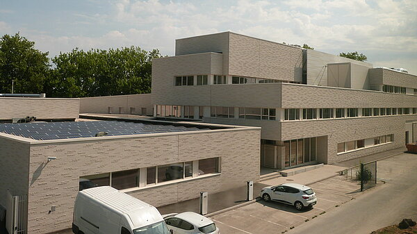

<html>

<body>

<!---->

<h1>Workshop venue </h1>

The workshop will be held at the amphitheater of he IEMN ("Institut d'électronique de microélectronique et de nanotechnologie"), at the <i>Cité Scientifique</i> campus of the University of Lille.  
<b>Address:</b> IEMN, Cité Scientifique, Avenue Henri Poincaré CS 60069, 59652 Villeneuve d'Ascq, France.   
Further directions to the site, click <a href="https://www.iemn.fr/en/contact" target="_blank">here</a>  
  

<table>
  <thead>
    <tr>
      <th></th>
    </tr>
  </thead>
</table>   

<iframe src="https://www.google.com/maps/embed?pb=!1m18!1m12!1m3!1d4100.287353260589!2d3.141368088369234!3d50.60377283755482!2m3!1f0!2f0!3f0!3m2!1i1024!2i768!4f13.1!3m3!1m2!1s0x47c2d6518757961d%3A0xc7e0c4805cba4276!2sInstitut%20d'%C3%A9lectronique%20de%20micro%C3%A9lectronique%20et%20de%20nanotechnologie!5e1!3m2!1sca!2sfr!4v1793264934385!5m2!1sca!2sfr" width="600" height="450" style="border:0;" allowfullscreen="" loading="lazy" referrerpolicy="strict-origin-when-cross-origin"></iframe>

The best option is to go with metro line 1 from the main train station <i>Gare Lille Flanders</i>, direction <i>Villeneuve D Ascq 4 Cantons Stade P. Mauroy</i> and stop at the station <i>4 Cantons Stade P. Mauroy</i>. It takes about 15 minutes from the main station.   More details can be obtained via the public transport company website : <a href="https://www.ilevia.fr" target="_blank">https://www.ilevia.fr</a>  

<iframe src="https://www.google.com/maps/dir/Lille+Flandres,+Pl.+de+la+Gare,+59800+Lille/Institut+d'%C3%A9lectronique+de+micro%C3%A9lectronique+et+de+nanotechnologie,+1+bis+Av.+Henri+Poincar%C3%A9,+59650+Villeneuve-d'Ascq/@50.6312827,3.1086882,8295m/data=!3m1!1e3!4m14!4m13!1m5!1m1!1s0x47c2d58bd35d633b:0x2dd8c0c3f5f43032!2m2!1d3.070412!2d50.636553!1m5!1m1!1s0x47c2d6518757961d:0xc7e0c4805cba4276!2m2!1d3.1379091!2d50.6038715!3e3?entry=ttu&g_ep=EgoyMDI2MTAyMC4wIKXMDSoASAFQAw%3D%3D" width="600" height="450" style="border:0;" allowfullscreen="" loading="lazy" referrerpolicy="no-referrer-when-downgrade"></iframe>   

There are various hotels near the Gare Lille Flandres, Gare Lille Europe or Rihour metro stations, which are conveniently close to the metro line 1 to go to "4 Cantons Stade P. Mauroy". 

</body>
</html>
